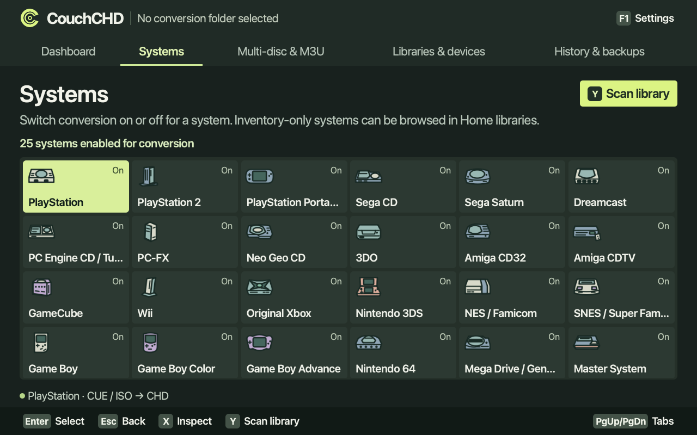
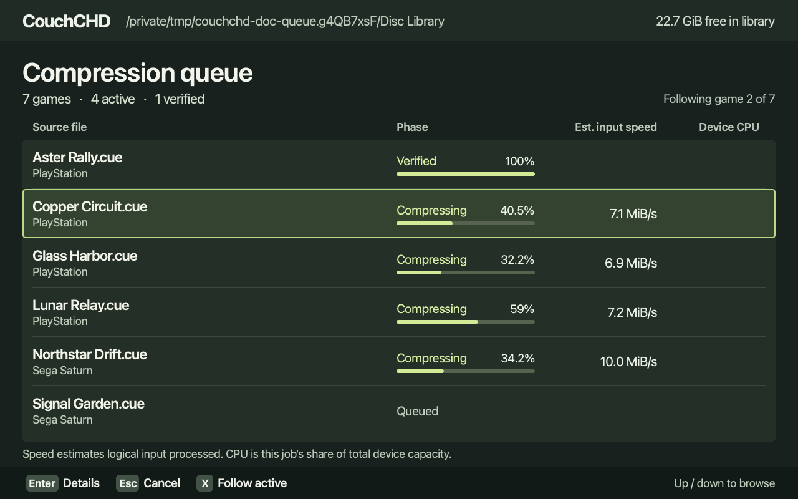
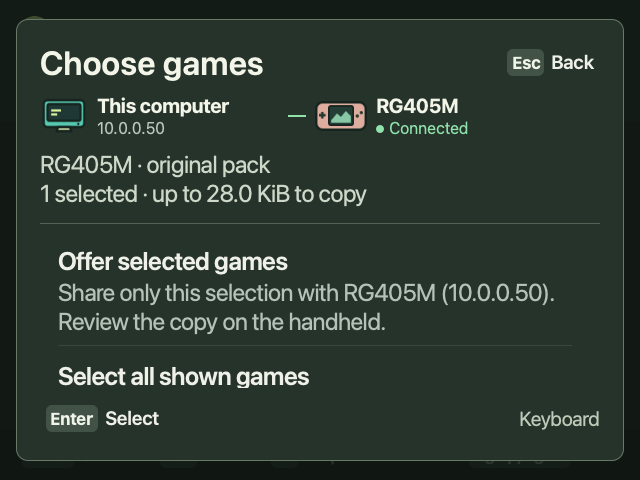
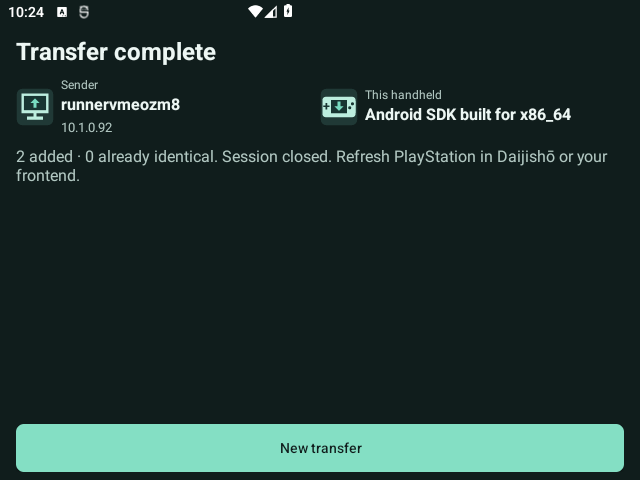

# CouchCHD

```text
  .--------------------------------.
  |    .--------------------.      |
  |  + |  C O U C H C H D   |  (B) |
  |    |    PRESS START >   | (A)  |
  |    '--------------------'      |
  '--------------------------------'
```

Make room for more games without losing track of your originals. CouchCHD is a controller-first ROM compressor for Steam Deck, Linux desktops and supported retro consoles. Convert a working copy, verify it, then decide what to keep. Already have a compressed game on another drive? Copy it instead of compressing it again.

**Start here:** [Install](#install-from-github) · [Will it run on my device?](#device-compatibility) · [Try one game](#first-run-try-one-game) · [Watch the queue](#compression-queue) · [Send to Android](#anbernic-rg405m--android--daijishō)

**Field manual:** [Formats](#formats-and-emulator-compatibility) · [Multidisc games](#multidisc-games-and-playlists) · [ZIPs](#mixed-folders-loose-discs-and-zips) · [Libraries & NAS](#reuse-compressed-games-across-devices) · [Health, space & undo](#make-room-without-guessing-which-originals-to-delete) · [Controller](#controller) · [CLI](#run-from-source)

## Install from GitHub

**Steam Deck or Bazzite:** open Konsole in Desktop Mode. For Gaming Mode registration, choose **Steam → Exit** first. **Recalbox:** SSH into the Pi. Run this at the prompt **on the device that will run CouchCHD**:

```sh
curl -f https://vip3rousmango.github.io/couchCHD/i | sh
```

The installer verifies the download and sets up the launcher. **It does not convert or delete games.** On a Deck, don't use `sudo`. No clone, Python install or GitHub login needed. To inspect the script first, download it, read it, then run `sh install-device.sh`.

## Device compatibility

**Where you compress a game and where you play it can be different.** You can compress a PS1 disc on Bazzite and send the CHD to an RG405M. For ANBERNIC models, check the full name and firmware: **RG Cube** runs Android, while a stock **RG CubeXX** uses a Linux card workflow. [Look up your model, firmware and player](docs/device-compatibility.md#find-your-anbernic-model-and-firmware).

| Device or setup | What you can do | Where to start |
| --- | --- | --- |
| Steam Deck (SteamOS), Bazzite and compatible Linux desktops | Compress, verify, undo and send games. The published builds require x86-64 or ARM64 Linux with glibc 2.36+. | Deck: **Library → Non-Steam → CouchCHD**. KDE: **Applications → Utilities → CouchCHD**. |
| Raspberry Pi 4 with 64-bit Recalbox | Convert locally on a compatible image, or pull a ready copy instead. A 32-bit Pi OS is not supported by the installer. | Install over SSH, restart Recalbox, open **Ports → CouchCHD**. [Other frontends](#launchers-and-updates) have different menu entries. |
| Android 8+ handheld, including the RG405M | Receive selected games over Wi-Fi. The APK doesn't compress games or install an emulator. | Open [CouchCHD Receive](https://vip3rousmango.github.io/couchCHD/receive/) and choose the folder your player already uses. |
| Linux handheld with a supported firmware/player profile | Export playable files to its mounted card. A card profile does **not** mean the device runs CouchCHD or accepts wireless transfers. | On the host, choose **Prepare a game pack**. [Find your firmware](docs/device-compatibility.md). |
| Windows/macOS machine or an existing NAS | No native Windows or macOS release installer. A Linux host can still use a mounted library or a configured remote as a source. | [Browse or pull from a home library](#reuse-compressed-games-across-devices); leave the master read-only. |

## First run: try one game

1. **Choose a working ROM folder**, not your only copy. Select the root containing your system folders, such as `roms/psx/`. CouchCHD works alongside EmuDeck; it doesn't install emulators or download games. Use images you are authorized to process.
2. **Start small.** Choose **Keep originals**, select a system in **Systems**, and scan. Try one game before a whole card. Keep a CUE sheet with its track files; don't convert the tracks individually.
3. **Play the verified output in your emulator.** Load a save and, for a multidisc game, try a disc swap. Verification checks the image, not your player's compatibility. [Review backups](#make-room-without-guessing-which-originals-to-delete) before reclaiming space: **permanent cleanup ends Undo**.



## Compression queue

Open a working library, select the games you want in **Dashboard → Queue**, then choose **Start batch**. Use the D-pad to browse individual jobs while they run. A disc can finish compression and still be **verifying**; the percentage is for the current stage, not the entire batch.



**Reading the numbers:** MiB/s estimates source data processed, not SD-card write speed. Device CPU is the job's share of total capacity; it stays blank when unavailable. This desktop run used seven generated discs, not commercial games. It isn't a Steam Deck benchmark: [recognized Decks and Pis run one disc at a time](#large-batches-on-a-deck-or-pi).

## Launchers and updates

**Update from the couch:** when idle, open **Settings → Update CouchCHD**, then exit and reopen the app. Expand the notes below for older installs, launcher artwork or a shortcut that returns to Steam.

<details>
<summary><strong>Install requirements, single-card Recalbox, Steam shortcuts and updates</strong></summary>


The installer selects the x86-64 AppImage, aarch64 tarball or single-card Recalbox image from the pinned [GitHub testing release](https://github.com/vip3rousmango/couchCHD/releases/tag/v0.1.0-preview.20), verifies SHA-256 against the release manifest, and runs `--version` before activating it. Both architectures require **64-bit Linux userspace, glibc 2.36+**, and compatible graphics/input drivers for the UI. A Pi 4 running a 32-bit image is not supported.

Desktop Linux gets an Applications menu entry and launches immediately if a graphical display is available. On appliances the installer registers the launcher, tells you how to refresh the menu, and leaves the current frontend running. Setup does not convert or purge anything.

**Pi 4 / Recalbox over SSH:** run the public install command above **at the Pi prompt**. On a single SD card with [Recalbox 10.1.2’s exFAT masks](https://gitlab.com/recalbox/recalbox/-/blob/10.1.2/board/recalbox/fsoverlay/recalbox/scripts/recalbox-mount.sh) (`fmask=0133,dmask=0022`), setup stores a compressed SquashFS application image under `/recalbox/share/system/couchchd`. The launcher verifies it and mounts it read-only on demand. You don’t need another drive, an executable ROM partition, or enough RAM for a full unpacked copy. Use the normal Recalbox root login: this mode needs kernel loop and SquashFS support and permission to mount the image. Restart Recalbox when convenient and open **Ports → CouchCHD**. If Ports is hidden, enable **Show Ports System**.

Setup leaves the boot partition, SHARE mount options and ROMs alone. An explicitly `noexec` SHARE is **not** treated as an exFAT file-mode issue. In that case setup still looks for a separate trusted, executable Linux data volume and stops before downloading if none is available. If you already installed on another volume, leave it attached for launches and updates.

**Steam Deck / Gaming Mode:** In Desktop Mode, choose **Steam → Exit** (closing the window is not enough), then run the installer above. Setup registers the persistent `run-couchchd` launcher for your signed-in native Steam account. Return to Gaming Mode and choose **Library → Non-Steam → CouchCHD → Play**. You don't need to manually add the AppImage or desktop file. If you already did, leave the shortcut in place during setup.

**If Play immediately returns:** under the shortcut's **Properties → Shortcut**, Target should be `"/home/deck/.local/share/couchchd/run-couchchd"` for the default Deck installation, Start In should be `"/home/deck/.local/share/couchchd"`, and Launch Options should normally be empty. Under **Compatibility**, leave **Force the use of a specific Steam Play compatibility tool** unchecked: this app is native Linux. After attempting Play, inspect `~/.local/share/couchchd/steam-launch.log` in Desktop Mode. A fresh log means the launcher ran; if no fresh log appeared, check the target and compatibility setting first.

**Desktop Mode (including Bazzite):** search for **CouchCHD** in the application launcher, or open **Applications → Utilities → CouchCHD** on KDE. This installs a menu entry, not a file on your desktop. Fedora Atomic's `/home` → `/var/home` alias is supported; links inside your applications or icons directories are not followed. If an older installer printed “Installed” and then refused the menu path, exit CouchCHD and rerun the short install command in a desktop terminal to repair the entry. The x86-64 launcher uses software rendering to avoid OpenGL startup failures. In ES-DE, rescan the ROM directory and look under **Ports**.

**Update from the couch:** after installing preview.4 or later with the public installer, open **Settings → Update CouchCHD** when idle. One press checks the project's release channel and installs a newer verified build if available. Exit and reopen CouchCHD normally to use it; the updater doesn't restart Steam, change menu entries, or touch your ROM library. If you're on preview.3 or earlier, finish or cancel your batch, exit CouchCHD, then run the short install command once to get this option. Private and source installations stay on their existing update path.

After updating, reopen CouchCHD and choose **Settings → Refresh launcher artwork**. It fills missing portrait, landscape, hero, logo and icon slots and replaces recognized stock artwork; custom images stay untouched. For previews 1–4 the portrait and hero were drawn on-device, so replacement requires an exact match to the old render. Completely exit and restart Steam to reload cached art in both Desktop and Gaming Mode. If Refresh reports a missing shortcut icon, exit Steam in Desktop Mode and run Refresh again before reopening Steam. Recalbox reuses the portrait, and the desktop menu uses a persistent icon file.

</details>

<details>
<summary><strong>Launcher directory: Batocera, RetroPie, ROCKNIX, ES-DE and more</strong></summary>


| Detected frontend | Where to launch CouchCHD |
| --- | --- |
| [Recalbox EmulationStation](https://wiki.recalbox.com/en/advanced-usage/systems-display) | **Ports → CouchCHD** via a custom port system, not a Settings plugin. Restart Recalbox normally to reload the system list. Enable **Show Ports System** if hidden. |
| [Batocera](https://wiki.batocera.org/systems:ports) | **Ports → CouchCHD**; update the game lists. |
| [RetroPie](https://github.com/RetroPie/RetroPie-Setup/blob/master/scriptmodules/supplementary/retropiemenu.sh) | The **RetroPie configuration** carousel. Install as the frontend user, not with `sudo`. |
| ROCKNIX | **Ports → CouchCHD** on supported 64-bit images. |
| [Standalone EmulationStation](https://github.com/Aloshi/EmulationStation#writing-an-es_systemscfg) / [ES-DE](https://gitlab.com/es-de/emulationstation-de/-/blob/master/USERGUIDE.md) / native EmuDeck ES-DE | Uses a configured, shell-compatible Ports system. Rescan or restart the frontend after registration. Setup reports when it cannot safely register. |
| RetroDECK Flatpak | Use the host desktop or Steam entry. The installer doesn't grant sandbox permissions or insert a host executable into a sandbox that can't launch it. |

These are integration targets, not hardware certifications. Test with disposable media first; display drivers and the installed OS image matter as much as the board model.

</details>

### Recalbox Web Manager

The console app appears under **Ports**, not in Recalbox's browser sidebar.

<details>
<summary>Why there is no web plugin, and how to check history over SSH</summary>


**Ports → CouchCHD** opens the app on the console, not in a browser. In Recalbox 10.1.2, Manager v3's [sidebar](https://gitlab.com/recalbox/recalbox/-/blob/10.1.2/projects/manager3/src/layouts/MainLayout.vue) and [routes](https://gitlab.com/recalbox/recalbox/-/blob/10.1.2/projects/manager3/src/router/routes.ts) are compiled into the [system image](https://gitlab.com/recalbox/recalbox/-/blob/10.1.2/package/recalbox-manager3/recalbox-manager3.mk); its [ROM table](https://gitlab.com/recalbox/recalbox/-/blob/10.1.2/projects/manager3/src/components/emulation/EmulationSystemsRomsTabSystemContent.vue) has no launch action. We found no supported third-party menu registration. The installer doesn't patch Manager, remount the OS, or start a web service. A native browser tab would need an upstream extension point or an upstream CouchCHD integration.

To check conversion history from Bazzite without opening another network port:

```sh
ssh root@recalbox.local '/recalbox/share/system/couchchd/run-couchchd --root /recalbox/share/roms --history'
```

</details>

### Other Linux frontends

<details>
<summary>Register a shell-compatible Ports entry manually</summary>


For a frontend with an existing ROM root and a **Ports system configured to execute `.sh` files**, register explicitly if its layout wasn't recognized:

```sh
app=~/.local/share/couchchd/run-couchchd  # or the full launcher path printed by setup
"$app" --register-frontend ports "$app" --root /path/to/roms
```

This writes `ports/CouchCHD.sh`; it doesn't install an emulator or make an unsupported file type executable by a frontend. For launchers with an **Add application** workflow, point it at `run-couchchd` instead. Steam registration with artwork is available from inside CouchCHD's Settings. Console-only RetroArch/Lakka images without an external application launcher do not gain a Settings plugin. Neither macOS, Windows, musl-only Linux, nor 32-bit images can use these Linux binaries.

</details>

### Choose a handheld by firmware and player

Use **Prepare a game pack** to choose a destination profile, confirm the installed player/core, then choose games for a card or transfer. A profile is a format filter, not a discovered device. For a wireless connection instead, use **Connect a handheld**. When the firmware permits custom folders, choose the existing folder for that platform instead of creating a second library.

See the [Linux and dual-boot device research](docs/anbernic-linux.md) and [Android device research](docs/anbernic-android.md) for model variants, specifications, firmware evidence, and a physical-device checklist. These are **export destinations**, not a list of tested native Linux installs. A console can play a transferred game without running CouchCHD. On the command line, `--handheld-profiles` lists profile IDs and compatible player IDs; use `--handheld-profile ID` and repeat `--handheld-player ID` with `--handheld-list` or `--handheld-export`.

<details>
<summary>Testing an unfamiliar handheld? Generate a read-only device report.</summary>


**Testing an unfamiliar handheld?** Start with one nonessential game and its existing save. Record the model suffix, firmware name/version, exact player/core, card folder, whether the frontend finds it, controller navigation, and (where applicable) a disc swap. On a shell-accessible console, run this non-installing report for CPU userspace, RAM and visible tools:

```sh
curl -fsS https://vip3rousmango.github.io/couchCHD/i | sh -s -- --device-report
```

The report does not scan ROMs, change files, or upload anything. If there's no shell, **Settings → About** plus the emulator version is sufficient to start a test report.

</details>

### Anbernic RG405M / Android / Daijishō

**Play on the handheld; compress on the host.** The stock [RG405M](https://anbernic.com/products/rg405m) runs Android 12 on a T618. It doesn't need CouchCHD to play a game. For wireless transfers, use the Android app, not the Linux installer or a Daijishō player script.

**Leave the SD card in.** Install [CouchCHD Receive](https://vip3rousmango.github.io/couchCHD/receive/) on the handheld and join the same home network as your computer. No account, Samba share or third-party sync app required.

1. **Find each other.** On the computer, open **Dashboard → Connect a handheld** (also under **Libraries & devices → Nearby handhelds**). On the RG405M, open **Receive**. Leave both screens open; don't choose games or firmware yet.
2. **Pair.** Select **Found · Not paired** on the computer, then **Connect to …** on the handheld. You can also start with **Find sender** on the handheld. Compare codes; approve on the computer and choose **Codes match** on the handheld. **Connected** means paired, not copied.
3. **Offer games.** Choose titles from one platform in a saved library or folder. The RG405M profile covers PS1, PSP and Dreamcast; choose another profile/player only if you need different formats.
4. **Receive and play.** Choose Daijishō's existing platform folder (such as `ROMs/PSP`), then **Use this folder → Receive files**. Keep both apps open. After **Transfer complete**, choose **Sync** in Daijishō.

<p>
  
  
</p>

**Two sides of a transfer:** the desktop offers a selection; the handheld reports what it actually received. These are separate test runs: a desktop pairing session and the signed receiver running on an Android 12 emulator, not photos of a physical RG405M.

<details>
<summary>Nothing found? Check these before changing your network.</summary>

- Update both apps. Use the same home LAN; wired Ethernet on the computer is fine. Guest Wi-Fi can isolate devices.
- On Bazzite, choose **Allow on home network** if offered, then **Find sender** again. Or choose **Enter host IP** and type the computer's displayed IPv4 address without the port. Don't disable your firewall or forward router ports.
- A platform in your library is not a nearby device. A stock Game Boy, sleeping Deck or device without an open compatible app won't appear.

</details>

The receiver remembers the folder, skips byte-identical games and stops on conflicting copies. It doesn't mirror deletions or copy saves, BIOS files or settings.

<details>
<summary>Prefer a card reader? Card export, Daijishō folders and player compatibility</summary>


1. On Bazzite, a Steam Deck, or a remote supported Linux host, copy one game into a working ROM library (for example, `roms/psx/` with its `.cue` **and all referenced tracks**). Convert there with **Keep originals** or the [`--keep-originals` CLI example](#run-from-source). Wait for verification.
2. Choose **Prepare a game pack**, select the titles and point it at the mounted card's ROMs folder. CouchCHD copies supported PSX/Dreamcast CHDs, complete CHD playlists or PSP CHD/CSO, checks the copied bytes, skips identical files, and refuses conflicts. For MTP-only USB transfer, export to a local folder first, then transfer its contents yourself; that final manual copy is not verified by CouchCHD. Keep the master library until you've tested booting and changing discs.
3. In Daijishō highlight the platform, choose **Add more → Select folder → Sync** (just **Sync** if the folder is already registered). Choose a [player that accepts the output](https://github.com/TapiocaFox/Daijishou/wiki/Players-and-File-Extensions). For PS1, [Beetle PSX](https://docs.libretro.com/library/beetle_psx/#chd) supports CHD and M3U; launch the playlist for disc swapping. For GameCube/Wii, [Dolphin recommends RVZ](https://dolphin-emu.org/docs/faq/#supported-dump-formats), not this CHD workflow. Changing a [player's filename filter](https://github.com/TapiocaFox/Daijishou/wiki/How-to-Use-Daijish%C5%8D) can make a game visible but can't teach the emulator a new format.

For your PSP batch, select a current [PPSSPP](https://www.ppsspp.org/docs/getting-started/dumping-games/) build: CHD support starts at 1.17, and CouchCHD uses its recommended DVD image mode for PSP ISOs. Smoke-test a game in the chosen emulator before removing sources; a valid checksum does not prove that the installed player supports the image.

The companion receives games; it does not convert them or replace an emulator. You can open it from Daijishō's **Apps** tab or [pin-apps widget](https://github.com/TapiocaFox/Daijishou/releases/tag/v1.3.0). Android gives each app its own [folder permission](https://developer.android.com/training/data-storage/shared/documents-files#grant-access-directory); selecting a folder for the receiver does not change Daijishō's library paths.

</details>

## Optional: private SSH builds

<details>
<summary>Install a trusted private build from Bazzite instead of the public release</summary>


**Once on Bazzite:** keep this checkout at `~/couchCHD`. Put each trusted Linux build **and its matching `SHA256SUMS-<arch>`** in `dist/release/<arch>/`. These are the directories produced by `scripts/build_linux.sh` on native Debian 12 build machines. With a private Actions build, the equivalent download from the checkout is:

```sh
gh run download RUN_ID -n release-x86_64 -D dist/release/x86_64
gh run download RUN_ID -n release-aarch64 -D dist/release/aarch64
```

Only the target architecture is required. The source checkout alone is not a binary build. Do not generate a new checksum for an untrusted download.

**Pi 4 / Recalbox — type this on Bazzite**, from the checkout, substituting your normal SSH destination:

```sh
python3 scripts/send-device.py root@recalbox.local
```

Bazzite probes the target over SSH and streams the matching artifact. No Python, GitHub token, HTTP server, or internet connection is needed on the target. Installation and frontend registration are the same as for the public installer.

**Steam Deck — type this in Desktop Mode’s Konsole.** Set `host` to your Bazzite SSH login; Bazzite must accept SSH connections. Confirm its host-key fingerprint on first use. SSH keys avoid repeated password prompts.

```sh
host=user@bazzite.local; ssh "$host" 'cat couchCHD/scripts/install-device.sh' | sh -s -- "$host"
```

The Deck downloads the x86-64 AppImage from Bazzite, checks SHA-256, and opens the UI as your normal desktop user. Relaunch with `~/.local/share/couchchd/run-couchchd` (under `$XDG_DATA_HOME` if set). If the Deck accepts SSH, the Bazzite push command also works with `deck@steamdeck.local`; a display-less session prints the launcher path instead of opening a window.

Both paths stage and test the executable before switching the launcher. Repeating setup reuses the same build directory. Distinct previous builds remain under `builds/`; configs, originals, backups and the undo ledger are not replaced. No release is published and no system partition is remounted.

</details>

## Formats and emulator compatibility

Choose a format for the **emulator that will play the game**, not just the smallest file. CouchCHD does not transcode an entire directory based on filename extension alone.

| Input | Output | What matters |
| --- | --- | --- |
| Supported CD/GD collections (`.cue` plus tracks; Dreamcast also `.gdi`) and PS2 DVD images | CHD | Existing PS1, PS2, Dreamcast, Saturn and Sega CD support, plus CUE-based PC Engine CD, PC-FX, Neo Geo CD, 3DO, Amiga CD32 and CDTV for compatible cores. Do not convert individual track files. |
| PSP ISO | CHD (default) or CSO | Choose the PSP format in Settings or pass `--psp-format cso`. Existing files are not renamed. |
| Raw GameCube or Wii ISO | RVZ | Dolphin format; no scrubbing. Compare decoded data against the source before publishing. |
| Original Xbox full-disc XGD1 image | `.xiso.iso` | A playable filesystem repack, **not** a sector-exact backup. Existing XISOs and Xbox 360 discs are not candidates. Always retains the input. |
| Nintendo 3DS CARD1 `.3ds` / `.cci` | `.trim.cci` | Preserves cartridge content and removes known padding; uses the [CCI extension accepted by Azahar](https://azahar-emu.org/blog/game-loading-changes/). Trimming does not decrypt a game. Writable CARD2 and ambiguous images are not eligible. Always retains the input. |
| Recognized single-cartridge ROMs for supported NES, SNES, Game Boy, GBA, N64, Mega Drive, Master System and Game Gear cores | `.7z` | One ROM per archive; verify the extracted bytes. Check that your frontend **and core** support archives. No arcade sets, BIOS collections, disc tracks or nested archives. |

Already use EmuDeck? Keep using it for emulator setup. After changing launch paths, rescan ES-DE or rerun Steam ROM Manager as appropriate. The [EmuDeck comparison](docs/emudeck-comparison.md) explains the different workflows; the table above lists CouchCHD's current formats.

### Multidisc games and playlists

**Want one library entry instead of “Disc 1” and “Disc 2”?** For **PlayStation, Sega CD, Saturn and Dreamcast**, CouchCHD can group numbered sibling CHDs it has verified. The `.m3u` is the entry you launch; the discs stay together in `.chd_discs/`. Open **Multi-disc & M3U** to inspect the playlist. Missing numbers, conflicting editions or an existing playlist are reasons to leave a set alone.

Back up saves before changing the launch name. Open the playlist in your actual player, load an existing save and try a disc swap. A player that accepts CHD does not necessarily accept M3U. When transferring a supported set, select the **playlist** so its referenced discs go with it.

### Mixed folders: loose discs and ZIPs

Do **not** unpack an entire collection first. A normal scan distinguishes loose discs, supported single-disc ZIP packages, already-playable cartridge archives, and packages that need manual review. An archive is not permission to overwrite a loose game with the same output name.

- **PSP ZIP → CSO:** choose CSO in Settings. CouchCHD reads the ISO member as a stream and opens it again to verify the resulting CSO sector by sector. The card needs space for the new output and a safety reserve, **not** for a temporary ISO.
- **ZIP → CHD or RVZ:** these tools need a seekable disc file. CouchCHD stages one supported disc at a time, checks space on the actual scratch and output filesystems, and removes its temporary data on completion or cancellation. On one volume, budget for **the expanded disc plus a conservative output allowance and reserve**, in addition to the ZIP already on disk. To put the expanded copy on a different disk, choose a temporary workspace or pass `--scratch /path/to/existing/folder`.
- **Original ZIPs stay put**, including under immediate cleanup. An emulator-ready output can be larger than its ZIP: packaging for play is not necessarily reclaiming space. ZIP conversions therefore do not count toward a space-recovery target. Encrypted, nested, ambiguous and unsupported packages are not bulk-extracted.

<details>
<summary>Accepted ZIP layouts, size limits and read-only NTFS sources</summary>

Accepted disc ZIPs are stored or DEFLATE-compressed (including ZIP64), with one supported ISO/GCM or one CUE/GDI and only its referenced tracks. The reader limits a package to 256 entries, a 256 KiB central directory, a 1 MiB descriptor and 16 GiB of expanded disc data. Extra games, unrelated files and nested archives require manual review. The ZIP filename supplies the output title, not the internal ISO filename.

For a read-only NTFS collection on Bazzite, use **mounted-folder ingest** into a separate writable library. Use the compressed catalog instead of ingest when another machine already has a playable output. Remote archive URLs and RAR/7z disc containers are not streamed as ZIPs; mount the source or handle unsupported packages separately.

</details>

### Reuse compressed games across devices

1. **Add a source** in **Dashboard → Home libraries** or **Libraries & devices**. Give it a name, whether it's an EmuDeck folder, a mounted NTFS drive or a handheld card. Saving scans all its subfolders.
2. **Browse by system** to see playable outputs alongside originals that still need conversion. A disconnected drive keeps its last inventory; reconnect it to transfer. Matching paths don't prove two discs or regions are identical.
3. **Refresh an existing library** after updating. Names like `Sony - PlayStation Portable` and `Sega 32X` work without renaming folders.

**Recognized doesn't mean convertible.** The Systems screen marks inventory-only platforms separately. A generic `Atari` folder may contain several systems; for a ZIP with no clear match, choose **Show unclassified examples** to see its path.

<details>
<summary>Configure mounted shares or rclone and pull a game from the command line</summary>

Sources can be existing mounted directories (local, SMB, NFS, SSHFS) or **already configured** rclone remotes, including SFTP. For SFTP, verify the peer's SSH host key and configure rclone's `known_hosts_file`. A Pi without rclone can use an OS-mounted share. The catalog has no listener, automatic enrollment, background mirror or delete propagation. Device pairing opens a separate temporary sender; the handheld cannot browse your library. Only the files you explicitly offer can be received.

```sh
couchchd --catalog-add 'Deck' deck:/home/deck/Emulation/roms
couchchd --catalog-add 'Windows master' /mnt/windows/roms
couchchd --catalog-refresh
couchchd --catalog-list
# Choose a source ID and a relative path from the listing:
couchchd --catalog-pull SOURCE_ID 'psx/Example.chd' --dest /games/roms
```

`deck:` above must already exist in the **receiving** device's rclone configuration. Pull verifies transferred bytes, not emulator compatibility or the relationship to a raw ISO. Configured remote transfers may read the selected payload twice for independent verification. They do not add play-test marks or authorize deletion of any original.

</details>

### Make room without guessing which originals to delete

Choose a writable **working library** for conversion. If Bazzite can see a Windows NTFS drive with your master dumps, leave it mounted read-only and use it as an ingest source, not the conversion destination. Health checks and handheld exports can read a separate source folder without opening its conversion ledger.

| What you're trying to do | Open this in CouchCHD |
| --- | --- |
| Find out why a game was skipped | **Dashboard → Library health check** reports missing tracks and broken playlist paths without editing them. |
| Estimate how much room you can make | **Dashboard → Make room on this card** previews all or selected systems and excludes games that can't be staged safely. Originals and outputs coexist until cleanup; the estimate isn't free space yet. |
| Reclaim space after testing | **History & backups → Play-test your games**, then **Review tested backups**. Test saves, music and disc swaps in the emulator; the app can't infer those from a checksum. |
| Restore sources after a batch | **History & backups → Undo last batch** restores quarantined originals without overwriting conflicts. It cannot recover purged files. |
| Get a playable BIN/CUE from a CD or GD-ROM CHD | In **Dashboard → Output files**, inspect the CHD and choose **Extract CD to BIN/CUE**. Extraction isn't Undo: it doesn't reproduce original filenames or descriptor text. |

Before confirming cleanup, read the file list and affected batches. **Permanent deletion ends Undo for those batches.** Keep an independent copy of originals you can't replace.

<details>
<summary>Plan and reclaim space over SSH with a scoped cleanup token</summary>

The same workflow works over SSH. For example, on a **working copy** of a PSP library:

```sh
couchchd --root /games/roms --health
couchchd --root /games/roms --system psp --plan-gib 10 > /tmp/space-plan.json
cat /tmp/space-plan.json
couchchd --root /games/roms --apply-plan /tmp/space-plan.json
couchchd --root /games/roms --review
```

Use the ID from `--review` with `--mark-tested ID` after playing. `--review-cleanup` lists exactly which backups are eligible and returns a confirmation token. `--reclaim-reviewed TOKEN --yes` is the **scoped** cleanup command; the older `--purge --yes` is **not** a shortcut for it.

</details>

## Run from source

Python 3.11+. CHD conversion/extraction requires `chdman` 0.256 or newer (`COUCHCHD_CHDMAN`, bundled copy or `PATH`); RVZ requires DolphinTool. Scanning doesn't need either helper. Optional cloud ingestion uses an already configured `rclone` installation. A mounted NAS needs no rclone configuration.

```sh
python3 -m venv venv
. venv/bin/activate
python -m pip install '.[gui,test]'
couchchd --root ~/Emulation/roms
```

For a headless install, use `python -m pip install .` instead. Select the **ROM root** (the directory containing `psx/`, `dreamcast/`, etc.). Use the same root for every instance. Do not point another instance, transfer tool, or emulator at a subdirectory that is already being processed. Do not move the library or edit the database during a batch.

<details>
<summary>CLI cookbook: scan, convert, ingest, inspect history, undo and extract</summary>

```sh
# Inspect without converting or moving any ROMs. Writes lock/history in the library.
couchchd --root /games/roms --headless
# Verify first with originals left in their current locations.
couchchd --root /games/roms --headless --auto --system psx --keep-originals
# Use CSO for PSP; keep the original ISOs for emulator testing.
couchchd --root /games/roms --auto --system psp --psp-format cso --keep-originals
# Convert a different system and quarantine its verified originals (the default).
couchchd --root /games/roms --headless --auto --system saturn
# Read one disc at a time from a configured remote; never delete remote originals.
couchchd --root /games/roms --auto --ingest 'gdrive:Disc archives'
couchchd --root /games/roms --history
couchchd --root /games/roms --undo
couchchd --root /games/roms --extract '/games/roms/psx/Example.chd' --dest /games/extracted
```

Headless commands print JSON to stdout and progress/errors to stderr. Batch exit status: `0` completed, `1` error, `2` paused/cancelled. After fixing a storage or battery warning, start the batch again. Existing CHDs are not overwritten. Inspect scan issues separately: an archived, incomplete, or invalid input is not a successful conversion.

</details>

### Large batches on a Deck or Pi

Treat the CPU budget and the compression speed as separate settings: using fewer CPUs leaves room for Gaming Mode, while doing less work per sector can make an ISO finish sooner. A busy CPU core can still show 100%; the converter's limit is relative to **all available logical CPUs**, not a guarantee about package temperature, power draw, or other applications.

<details>
<summary>CPU budgets and temperature limits on portable hardware</summary>

Recognized Decks and Pis run **one disc at a time**, including verification. On an eight-thread Deck, Balanced and Docked allow the compressor five logical CPUs (62.5%); Silent allows four. A four-core Pi 4 allows two, or one on models with 2 GiB RAM or less or unknown memory. On these devices a detected temperature of 80°C or higher reduces the active conversion to one CPU for the rest of the disc. Limits rely on Linux CPU affinity and visible sensors; they are not a thermal guarantee.

On Linux, portable conversion workers run at lower scheduling priority. When CPU topology is available, the compressor leaves one physical core and its SMT siblings available to the frontend if the process has access to another core. This leaves room for the controller and compositor; it does not set a frame rate or restrict other applications.

</details>

If the device feels too hot during a batch, press **B → Cancel batch** and wait for confirmation. Completed verified discs stay in History. The interrupted disc restarts from its original on the next batch; it does not resume from a partial CHD. Let the device cool before restarting or updating.

## What verification covers

**A verified image is not a play-test, and quarantine is not a backup drive.** Undo can restore quarantined originals until you purge them. Keep an independent copy of anything you can't replace.

<details>
<summary>Disc checks, codec choices, the undo ledger and permanent purge</summary>

- CUE/GDI tracks must resolve to nonempty regular files; ambiguous case matches, unsupported layouts, truncated sectors, and active transfers are not eligible. Original descriptors are never edited in place. ISO images require a recognized volume header. See [the system and format table](SPEC.md).
- CD always retains the default `createcd` hunk size. Portable devices try CD Deflate and CD FLAC, skipping LZMA; other systems keep the default codec search. DVD-mode ISOs (PSP and PS2 DVD) use `createdvd -hs 2048 -c zlib`. Trying fewer lossless codecs can finish sooner at the cost of a larger file on some discs. Both raw and overall SHA-1 and matching disc geometry are still required. The RetroAchievements indicator describes this format policy, **not** a network lookup or proof that a game is in the RetroAchievements database.
- Originals move to `_couchchd_backup/` only after verified publication. Shared tracks stay in place while a live descriptor might still need them. Relative `.m3u` entries point to `.chd_discs/`; single discs keep their normal CHD names. Stop Recalbox EmulationStation before metadata changes; re-run Steam ROM Manager after paths change.
- The SQLite ledger (`couchchd_history.db`) tracks filesystem operations. Undo restores originals without overwriting conflicts and retains generated game images under `_couchchd_backup/.undo/`. Editing or replacing an output invalidates its backup-purge proof. XISO and trimmed 3DS outputs never authorize source removal.
- Quarantine on the same volume does **not** reclaim space. After testing the CHDs in your emulator and making an independent backup, `couchchd --root /games/roms --purge --yes` permanently deletes authenticated quarantined files. A purged batch cannot be undone. BIN/CUE extraction creates a playable disc representation, not an exact reconstruction of original descriptor text, filenames, or layout.

Quarantine is not protection against drive failure. Keep an independent backup of valuable dumps and the ledger. For a NAS, use a filesystem with working cross-process locks, flush, and rename semantics. For local scratch use a fast filesystem with adequate headroom (`TMPDIR` on Linux). Recalbox data belongs on the persistent `/recalbox/share` partition.

</details>

## Controller

| Input | Action |
| --- | --- |
| D-pad / left stick | Move |
| South / east | Confirm / back |
| West / north | Inspect / use the current primary action |
| Bumpers / Start | Switch tabs / open Settings |

Prompts follow the controller family. Use a **gamepad** Steam Input layout, not a keyboard-emulating layout. All dialogs stay in one window.

Settings offers three cleanup policies: quarantine (default), keep in place, and immediate deletion. Immediate deletion requires an explicit confirmation, authenticates backups for the current job, and cannot be undone. It never authorizes purging unrelated backups.

## Development and distribution

```sh
python -m pytest
```

Tests use synthetic sectors and temporary libraries, not bundled ROMs. Install `chdman` or set `COUCHCHD_CHDMAN` to exercise the real conversion round trips as well as fault-injection tests.

Native release artifacts include the converter tools and notices; the source checkout does not contain ready-to-run Linux bundles. The build compiles `chdman` from [pinned MAME source](scripts/fetch_chdman.sh) and packages [DolphinTool](scripts/package_rvz.sh) for RVZ. Conversion tests use the frozen app on native x86-64 and aarch64 runners. These tests do not certify a particular GPU driver, console, emulator or game.

On GitHub, run **Native Linux release candidates** manually to build both architectures without publishing. Numeric preview tags (`vX.Y.Z-preview.N`) publish test prereleases after native build checks; other version tags stage drafts for maintainer review. See [bundle installation and checksums](packaging/INSTALL.txt).

CouchCHD is licensed under [GPL-3.0-only](LICENSE). MAME, Qt, SDL and other distributed dependencies retain their respective licenses. Product requirements and platform caveats are in [SPEC.md](SPEC.md).
